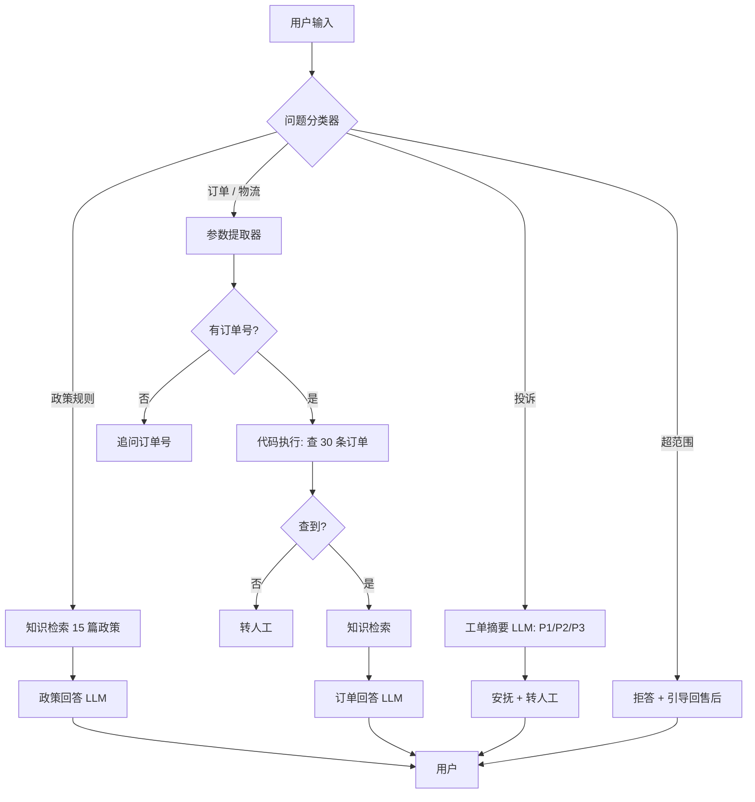

# 售后智服 · 解决方案文档

- 项目：云鲸数码售后 AI 助手（Dify Chatflow）
- 版本：v2.1，发布版本 `be016de2-e523-4e01-83f3-3bcf79cb69f4`
- 日期：2026-11-09
- 一句话：把售后政策查询和订单状态判断压缩进一次对话，能答的带出处答，答不了的带分级摘要转人工。

> 全文 8 页，每页开头一句结论；没参与过项目的人可以按顺序读完。

---

## 第 1 页｜背景

**结论：售后咨询的成本不在「答不出」，而在每次都要重新查政策、查订单、组织话术。**

云鲸数码自营店铺卖数码 3C、家电和生鲜，售后咨询集中在五类：退换货政策、订单状态、订单+政策复合、物流异常、投诉赔付。现状是一线客服人工判断意图 → 翻 15 篇政策文档 → 切订单系统 → 组织回复 → 拿不准转二线。

| 痛点 | 表现 | 量化（估算） |
|---|---|---|
| 重复劳动 | 同一批规则每天被反复问 | 单次 3–5 分钟：查政策约 2 分钟、查订单 1–2 分钟、组织话术约 1 分钟 |
| 信息割裂 | 「我这单能不能退」要同时看订单和品类政策 | 复合问题约 30%–40% |
| 口径不一 | 新人记不住例外；投诉升级靠个人经验 | 改造前投诉 4 条只过 2 条，摘要没有分级 |

没有线上会话日志，以上是流程拆解估算，可靠的是量级不是绝对值；上线后用 1–2 周真实日志校准。

机会在于三个前提同时成立：政策文本可结构化（15 篇，带例外）、订单字段可结构化查询（30 条模拟数据）、问题可分类路由。这决定了它适合做成「检索 + 工具 + 路由」的 Chatflow，而不是一个万能提示词。

---

## 第 2 页｜场景

**结论：选「售后咨询的前置判断」而不是「全流程自动化」，因为高频、可结构化、失败可转人工。**

| 维度 | 定义 |
|---|---|
| 用户 | C 端买家（最终用户）；一线售后客服（主要使用者） |
| 场景 | 签收前后的售后咨询，渠道为在线客服对话框，短句为主、常带订单号、常省略主语 |
| 期望 | 政策问题给结论和出处；订单问题按事实回答；投诉安抚并转人工；无关问题拒答 |
| 价值主张 | 能答的带出处直接答，需要查的用订单数据算，答不了的连 P1/P2/P3 摘要一起转人工 |

6 类意图与评测覆盖：

| 意图 | 典型问法 | 处理方式 | 覆盖 |
|---|---|---|---|
| 政策规则 | 「七天无理由有什么条件？」 | 检索 → 政策回答 | 8 条 |
| 订单状态 | 「订单 A2026… 到哪了？」 | 查单 → 订单回答 | 6 条 |
| 订单+政策 | 「这单耳机坏了能退吗？」 | 查单 + 检索 → 订单回答 | 5 条 |
| 物流规则 | 「放驿站还能验货吗？」 | 检索 05/06/07 号文档 | 4 条 |
| 投诉赔付 | 「赔我 1000 块」 | 工单摘要 → 安抚转人工 | 4 条 |
| 超范围 | 「写首诗」 | 固定话术拒答 | 3 条 |

不追求「AI 办完」，只追求「AI 把判断和材料准备好」：退款、退货、定责仍由人执行。

---

## 第 3 页｜架构

**结论：一个 Chatflow 四路分流——政策检索、订单查询、投诉摘要、超范围拒答；路由与生成分离。**

| 组件 | 配置 |
|---|---|
| 问题分类器 | 4 类：政策规则 / 具体订单 / 投诉 / 超范围；规则互斥；记忆窗口 6 条 |
| 参数提取器 | 抽订单号；记忆窗口 6 条 |
| 代码执行 | 30 条模拟订单；算下单天数、7 日窗口、发货超时、保修状态 |
| 知识检索 | 15 篇政策，通用分段 500/重叠 50，高质量索引，混合检索 Top K 5，Rerank 关 |
| LLM | `deepseek-flash`；政策/订单 0.3，投诉摘要 0.2 |
| 输出 | 政策/订单回答：结论—依据—出处；投诉：结构化摘要 + 分级 |

四个关键设计决策：

1. **订单事实由代码算，不让模型推日期。** 天数、窗口、超时都是确定逻辑，模型只负责解释。
2. **分类器用互斥规则，不用关键词。** 「破损/退货」在政策、订单、物流里都出现，按关键词必错。
3. **路由与生成分离。** 分类器固定 `deepseek-flash`，生成模型可替换；Day 11 实测切换 Qwen 不影响路由。
4. **无依据不硬答。** 检索不到就转人工；查无订单也转人工，宁可少答不编造。

---

## 第 4 页｜能力边界

**结论：只做「规则、状态、路径」，不碰「钱、权、隐私」。**

| 分类 | 定义 | 条数（20 条样本） |
|---|---|---|
| 直接答 | 知识库有依据，不依赖具体订单 | 5 |
| 查工具 | 必须读订单事实才能判断 | 6 |
| 必须转人工 | 定责、赔付金额、查无订单、投诉升级 | 5 |
| 必须拒答 | 与售后无关，或涉及他人隐私、越权操作 | 4 |

明确不做：

1. 不承诺赔付金额与结果（E25：拒绝「赔 1000 块」，转人工审核）
2. 不执行退款、退货、改地址、取消订单等写操作
3. 不查他人订单；知道订单号不等于有权限
4. 不回答售后之外的问题（E28–E30：写诗、公司地址、推荐手机）
5. 无依据不硬答（E07 过保条款缺失，转人工）

一条经验规则：**涉及钱、权、隐私的默认不自己办；涉及规则、状态、路径的可以先答。**

最大的边界不是「模型会不会答错」，而是**没有身份核验就开放订单查询**。当前 demo 按本人进线处理；生产环境必须先补身份核验，再开放订单详情。

---

## 第 5 页｜指标

**结论：30 条分层评测 28/30，能分别证明「该答的答、该转的转、该拒的拒」。**

| 指标 | 结果 | 口径 |
|---|---|---|
| 一次解决率 | **28/30（93%）** | 统一任务完成口径；v1 18/30，v2 首版 21/30 |
| 转人工准确率 | **6/6（100%）** | 6 条应转人工用例，摘要可用且带 P1/P2/P3 |
| 引用正确率 | **11/11（100%）** | 政策类 11 条，检索片段命中期望文档 |
| 幻觉率 | **0/30（0%）** | 与订单/知识库冲突或凭空编造 |
| 平均响应时间 | **7.0s** | blocking 端到端，含模型思考 |
| 平均轮次 | 未测量 | 脚本轮次是预设的；代理指标：多轮 4/4 通过 |

两轮迭代：

| 轮次 | 改动 | 结果 |
|---|---|---|
| Day 9 | 多轮记忆 + 订单时效布尔值 | 21/30 → 24/30 |
| Day 10 | 分类器互斥规则 + 投诉 P2/P3 | 24/30 → 28/30 |

剩余 2 条失败：E05 检索对了但模型漏「签收 24 小时内反馈」；E19 检索没召回拒收条款。两条都不是链路不通，而是单点质量。

口径提醒：30 条是分层小样本，判分为人工 + 判分代理，不能当线上指标承诺；E19 在轮次间存在判分松紧差异，报告里已按严格口径记录。

---

## 第 6 页｜成本

**结论：单次对话约 0.004 元，真正的成本杠杆在分类器（63% tokens），不在生成模型。**

| 项目 | 实测 |
|---|---|
| 单条对话 tokens | 3,046（30 条均值；15 条同题对比 DeepSeek 3,048 / Qwen 2,787） |
| tokens 分布 | 分类器 56.5% + 参数提取器 7.1% + 生成 36.4% |
| 单条成本（粗估） | `deepseek-flash` ≈0.0039 元；`qwen-plus` ≈0.0029 元 |
| 每千次对话 | ≈3.9 元 vs ≈2.9 元 |
| 每天 1 万次 | 月成本 ≈1,170 元 vs ≈870 元 |

口径：按 2026-11 公开标价近似（DeepSeek 输入 1 元/百万、输出 2 元/百万；Qwen-plus 0.8/2.0），未计 embedding、存储、缓存命中；Dify 日志里 `deepseek-flash` 未配置单价，`total_price` 为 0，**这是粗略估算，不是账单**。

选型结论：生成继续用 `deepseek-flash`。Qwen 更便宜、中位延迟略低，但 E12「订单已取消却让用户申请退款」暴露指令遵循风险；豆包无 Key 未实测，只做价格对比。

降本优先级：

1. 压缩分类器提示词（类别描述 + 记忆是 1,500 tokens/次的大头）
2. 分类器换更小模型（需单测路由准确率）
3. 最后才考虑换生成模型——两者单价差带来的绝对金额很小

---

## 第 7 页｜交付三阶段

**结论：先单品类试点，再接工单与身份核验，最后才开放写操作。**

| 阶段 | 周期（估算） | 范围 | 验收标准 |
|---|---|---|---|
| 一、试点 | 2–3 周 | 1 个品类 + 1 个渠道；用真实政策文档替换模拟知识库；保留 30 条回归集 | 30 条 ≥90%；6 条应转人工全部转对；0 幻觉；客服可用性访谈通过 |
| 二、扩量 | 4–6 周 | 全品类；接工单系统 API；补身份核验；加日志与质量看板 | 500 条抽检一次解决率 ≥85%；工单建单成功率 ≥99%；P2/P3 摘要准确率 ≥95% |
| 三、托管 | 持续 | 知识运营流程、模型路由与成本看板、季度边界审计 | 知识更新 48 小时内生效；月度成本偏差 <15%；投诉升级零漏标 |

阶段一的依赖：政策文档定稿、订单接口可读、客服主管确认口径。
阶段二的依赖：工单系统字段对齐、身份核验方案、隐私评审。
阶段三的依赖：知识 owner、运营排班、供应商稳定性。

人力估算（粗估）：阶段一约 9 人周（产品 1 + 开发 1 + 客服运营 1，3 周）；阶段二约 18–24 人周。

---

## 第 8 页｜风险

**结论：六类风险都有对应闸门；最大风险不是模型答错，而是没有身份核验就开放订单查询。**

| 风险 | 表现 | 闸门 | 现状 |
|---|---|---|---|
| 幻觉 | 编政策条款、赔付比例、物流轨迹 | 只依据检索回答；无依据转人工；订单事实由代码算 | 评测 0/30；E19 属检索未召回，单独归类 |
| 越权承诺 | 「肯定能赔」「一定退」 | 提示词禁止承诺金额；投诉只转人工 | E25 通过 |
| 隐私 | 输出地址/手机号、查他人订单 | 代码节点只返回商品/金额/状态/日期；他人订单拒答；生产补身份核验 | 评测未覆盖，v3 必补 |
| 情绪升级 | 用户越说越激动，AI 继续讲条款 | 投诉分支先安抚；P1/P2/P3 分级与 SLA | E24/E26/E27 通过 |
| 合规与知识时效 | 绝对化用语、政策过期仍按旧版回答 | 超范围拒答；政策版本管理与更新时间戳；季度审计 | 知识库 15 篇有版本；更新流程待建 |
| 平台依赖 | Dify 升级、模型下线、嵌入模型更换导致检索漂移 | 自托管 Docker；提示词与知识库留档；应用可导出 DSL；模型可替换 | 已完成一版模型切换实测 |

兜底原则：**任何一条链路失败，最终动作都是「转人工 + 结构化摘要」，而不是让模型自由发挥。**

---

## 附录｜资产与复现

| 内容 | 位置 |
|---|---|
| 场景 / 旅程 / 边界 | `01_场景定义.md`、`02_用户旅程.md`、`03_能力边界.md` |
| 知识库（15 篇） | `04_知识库/` |
| 订单数据与代码节点 | `06_订单数据/` |
| 30 条评测集与结果 | `06_评测/`（最终报告 `评测报告.md`） |
| 模型对比与成本 | `08b_模型选型与成本.md` |
| 搭建记录 | `07_Demo搭建记录.md`、`08_Chatflow搭建记录.md` |
| 截图 / 演示 | `05_截图/` |
